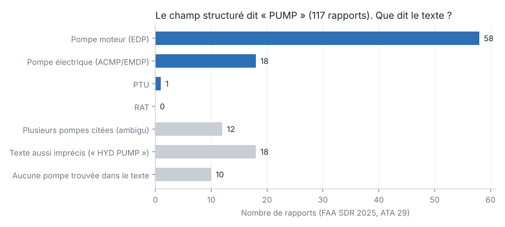
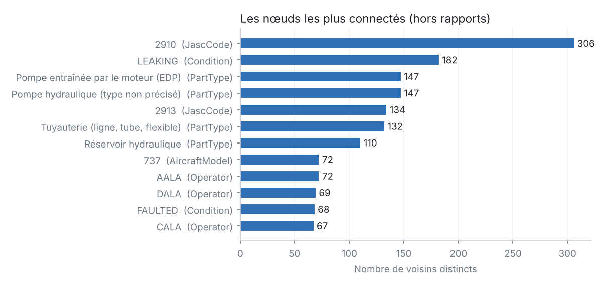

# Étape 1 — Résultats

Périmètre : **514 rapports** FAA SDR 2025, chapitre ATA 29 (hydraulique).

## Le graphe

| Type de nœud | Nombre |
| --- | ---: |
| Report | 514 |
| Aircraft | 430 |
| AmmTask | 198 |
| Operator | 58 |
| Condition | 54 |
| AircraftModel | 50 |
| Manufacturer | 23 |
| PartType | 18 |
| JascCode | 16 |

- 4676 faits extraits (chacun avec sa provenance), 3917 triplets distincts une fois les doublons fusionnés.
- Rapports sans aucune pièce reconnue : 44 (9 %).

## Os n°1 — Entity resolution : le cas des pompes

- Le champ structuré `PartName` vaut « PUMP » dans **117 rapports**.
- Ce champ ne dit pas de quelle pompe il s'agit. Le texte libre, lui, le dit souvent :

| Question | Champ structuré seul | Structuré + texte |
| --- | ---: | ---: |
| Rapports qui concernent une pompe moteur (EDP) | 0 | 147 |
| Rapports qui concernent une pompe électrique | 0 | 61 |

- **12 rapports citent plusieurs pompes.** Un dictionnaire trouve les mots, pas laquelle est en panne. C'est le travail de l'étape 2 (extraction par LLM).
- **Faux positif trouvé en vérifiant à la main** : « ADD EMP:U349218 » est un numéro d'employé, pas une « Electric Motor Pump » (EMP). Les 5 occurrences de « EMP » dans le périmètre étaient toutes des employés. Règle corrigée. Leçon : un dictionnaire se valide sur des exemples réels, pas seulement à la conception.

Exemples de rapports ambigus :

- `SWAA2025032007746` (ENGINE_DRIVEN_PUMP, ELECTRIC_MOTOR_PUMP) : « AFTER FLAPS 5 HYD A SYSTEM LOOW PRESSURE LIGHTS ON BOTH ENG AND ELECTRIC PUMP SHORTLY AFTER LOW PRESSURE LIGHTS ON HYD SYSTEM A CAME ON. SYS A QTY WENT TO 0. WE GOT EXTENDED VECTORS RAN QRH FOR LOSS OF SYSTEM A. RAN NON NORMAL LANDING DATA AND ALTERNATE EXTEND… »
- `DALA2025032402192` (ENGINE_DRIVEN_PUMP, ELECTRIC_MOTOR_PUMP, POWER_TRANSFER_UNIT) : « SHIP 9573 -ATB- ON ROTATION, THE CREW RECEIVED A "HYD R LO PRESS" MESSAGE AND THE INABILITY TO RETRACT THE GEAR. THEY MOVED THE GEAR SELECTION LEVER DOWN AND RECEIVED THREE GREEN "GEAR SAFE" INDICATIONS. AN EMERGENCY WAS DECLARED WITH ATC, THE FLIGHT RETURNED … »
- `YENA2025052700542` (ENGINE_DRIVEN_PUMP, POWER_TRANSFER_UNIT) : « FLT#1143, MHT-MCO. (AIRCRAFT DECLARED AN EMERGENCY INTO MCO). 'HYD G  ENG 1 PUMP LO PR  G SYS  LO PR  ECAM MESSAGE INFLIGHT DECLARED EMERGENCY.  THE PTU AND ENG PUMP WERE SHUT OFF WITHIN 2 MINUTES; OPENED AND INSPECTED #1 ENG. FOUND G HYD LINE #260 (REF IPC 29… »

### Variantes d'écriture trouvées dans le texte (top 8 types)

| Type canonique | Variantes distinctes | Exemples |
| --- | ---: | --- |
| Pompe entraînée par le moteur (EDP) | 20 | `EDP` (80), `ENGINE DRIVEN HYDRAULIC PUMP` (11), `ENG 1 PUMP` (10), `ENGINE DRIVEN PUMP` (8), `ENGINE HYDRAULIC PUMP` (7) |
| Réservoir hydraulique | 3 | `RESERVOIR` (63), `RSVR` (38), `RESERVOIRS` (7) |
| Tuyauterie (ligne, tube, flexible) | 17 | `HOSE` (26), `HYDRAULIC LINE` (25), `HYD LINE` (10), `HYDRAULIC PRESSURE LINE` (6), `HYDRAULIC LINES` (5) |
| Filtre | 2 | `FILTER` (40), `FILTERS` (26) |
| Pompe hydraulique (type non précisé) | 10 | `HYD PUMP` (27), `HYDRAULIC PUMP` (26), `HYDRAULIC SYSTEM PUMP` (3), `HYD PUMPS` (2), `HYD. PUMP` (2) |
| Pompe à moteur électrique (ACMP / EMDP) | 18 | `EMDP` (15), `ELECTRIC PUMP` (12), `ACMP` (11), `ELEC PUMP` (4), `ELECTRIC DRIVEN HYDRAULIC PUMP` (3) |
| Joint (O-ring, packing) | 8 | `O-RING` (20), `PACKING` (9), `SEAL` (8), `ORING` (5), `O-RINGS` (4) |
| Pressostat | 5 | `PRESSURE SWITCH` (25), `PRESS SWITCH` (5), `PRESSURE SWITCHES` (2), `PRESS SW` (2), `PRESSURE SW` (1) |

### Valeurs de `PartName` non reconnues : 55 valeurs, 101 rapports

`ELEC CONNECTOR` (8), `MODULE` (6), `LINE` (4), `VALVE` (4), `FUSE` (4), `SWITCH` (4), `INDICATOR` (3), `WARNING LIGHT` (3), `CONNECTOR` (3), `PCA` (3), `BEARING` (3), `WIRE HARNESS` (2), `SDAC` (2), `DRAIN VALVE` (2), `WIRE` (2)

Chaque valeur non reconnue = une décision d'ontologie à prendre (l'ajouter, la regrouper, ou l'ignorer).

## Os n°6 — Les hubs

Un GraphRAG naïf part de l'entité de la question et récupère tout ce qui est à N sauts. Question test : *« Quels problèmes touchent les pompes moteur (EDP) ? »*

| Sauts | Nœuds récupérés (naïf) | % du graphe | En refusant de traverser les hubs (≥ 50 voisins) |
| ---: | ---: | ---: | ---: |
| 1 | 148 | 11 % | 148 |
| 2 | 435 | 32 % | 435 |
| 3 | 828 | 61 % | 746 |
| 4 | 1326 | 97 % | 1178 |

- Hubs bloqués : 2910, 2913, 737, A320, AALA, CALA, DALA, FAILED, FAULTED, Filtre, Joint (O-ring, packing), LEAKING, Pompe hydraulique (type non précisé), Pompe à moteur électrique (ACMP / EMDP), Réservoir hydraulique, Tuyauterie (ligne, tube, flexible).
- À 3 sauts, la version naïve passe par les hubs (code JASC, état « LEAKING », constructeur…) et ramène une grande partie du graphe : le LLM est noyé.
- Bloquer les hubs réduit peu le bruit (et peut couper des chemins utiles). Le seuil est une décision ([D6] dans DECISIONS.md).
- **Ce qui marche : interroger par le schéma.** Le chemin `pièce <- rapport -> état / tâche AMM` (une requête Cypher ou SPARQL) ramène **251 nœuds**, chacun relié à la question par une relation qui a un sens. États les plus fréquents pour les EDP : LEAKING (38), FAILED (30), FAULTED (24), LOW PRESSURE (11).
- Limite honnête : l'état (`PartCondition`) est celui de la pièce du champ structuré. Si le rapport parle d'une EDP mais que le champ structuré vise un flexible, l'état n'est pas forcément celui de l'EDP. Encore un cas pour l'étape 2.
- Conclusion : le graphe apporte de la valeur quand on le parcourt avec son ontologie, pas quand on l'aspire « à N sauts ».

## Exports

- `property_graph/nodes.csv`, `edges.csv` : la provenance (source, rapport, texte justificatif) est une **propriété de l'arête**.
- `graphe.ttl` (RDF) : 3917 triplets distincts. En RDF, un triplet ne porte pas de propriétés : pour garder la provenance, chaque fait est **réifié** (4676 nœuds `rdf:Statement`). Même information, modèle beaucoup plus verbeux. C'est une vraie différence entre les deux mondes.
