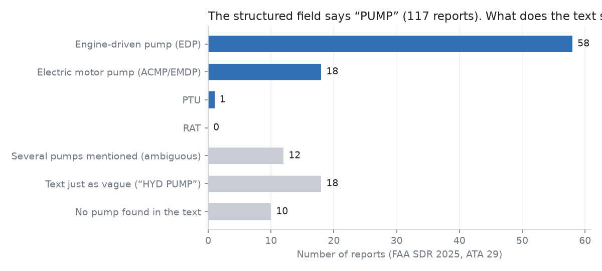
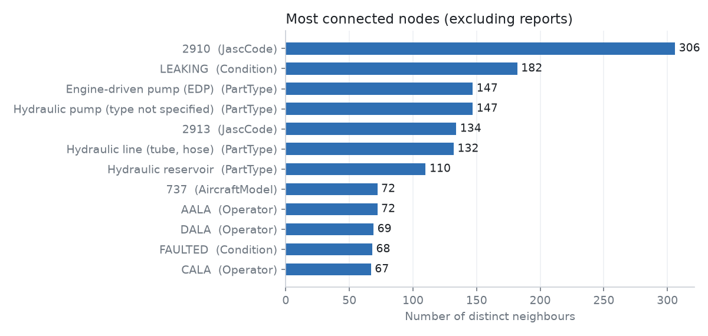

# Step 1 — Results

Scope: **514 reports**, FAA SDR 2025, ATA chapter 29 (hydraulic power).

## The graph

| Node type | Count |
| --- | ---: |
| Report | 514 |
| Aircraft | 430 |
| AmmTask | 198 |
| Operator | 58 |
| Condition | 54 |
| AircraftModel | 50 |
| Manufacturer | 23 |
| PartType | 18 |
| JascCode | 16 |

- 4676 facts extracted, each with its provenance; 3917 distinct triples once duplicates are merged.
- Reports with no recognised part: 44 (9%).

## Pitfall 1 — Entity resolution: the pump case

- The structured field `PartName` is just "PUMP" in **117 reports**.
- That field does not say which pump. The free text often does:

| Question | Structured field only | Structured + text |
| --- | ---: | ---: |
| Reports involving an engine-driven pump (EDP) | 0 | 147 |
| Reports involving an electric motor pump | 0 | 61 |

- **12 reports mention several pumps.** A dictionary finds the words, not which pump failed. That is the job of step 2 (LLM extraction).
- **False positive found by checking by hand:** in "ADD EMP:U349218", EMP is an employee number, not an Electric Motor Pump. All 5 occurrences of "EMP" in scope were employees. Rule fixed. Lesson: validate a dictionary on real examples, not only at design time.

Examples of ambiguous reports:

- `SWAA2025032007746` (ENGINE_DRIVEN_PUMP, ELECTRIC_MOTOR_PUMP): "AFTER FLAPS 5 HYD A SYSTEM LOOW PRESSURE LIGHTS ON BOTH ENG AND ELECTRIC PUMP SHORTLY AFTER LOW PRESSURE LIGHTS ON HYD SYSTEM A CAME ON. SYS A QTY WENT TO 0. WE GOT EXTENDED VECTORS RAN QRH FOR LOSS OF SYSTEM A. RAN NON NORMAL LANDING DATA AND ALTERNATE EXTEND…"
- `DALA2025032402192` (ENGINE_DRIVEN_PUMP, ELECTRIC_MOTOR_PUMP, POWER_TRANSFER_UNIT): "SHIP 9573 -ATB- ON ROTATION, THE CREW RECEIVED A "HYD R LO PRESS" MESSAGE AND THE INABILITY TO RETRACT THE GEAR. THEY MOVED THE GEAR SELECTION LEVER DOWN AND RECEIVED THREE GREEN "GEAR SAFE" INDICATIONS. AN EMERGENCY WAS DECLARED WITH ATC, THE FLIGHT RETURNED …"
- `YENA2025052700542` (ENGINE_DRIVEN_PUMP, POWER_TRANSFER_UNIT): "FLT#1143, MHT-MCO. (AIRCRAFT DECLARED AN EMERGENCY INTO MCO). 'HYD G  ENG 1 PUMP LO PR  G SYS  LO PR  ECAM MESSAGE INFLIGHT DECLARED EMERGENCY.  THE PTU AND ENG PUMP WERE SHUT OFF WITHIN 2 MINUTES; OPENED AND INSPECTED #1 ENG. FOUND G HYD LINE #260 (REF IPC 29…"

### Spellings found in the text (top 8 types)

| Canonical type | Distinct spellings | Examples |
| --- | ---: | --- |
| Engine-driven pump (EDP) | 20 | `EDP` (80), `ENGINE DRIVEN HYDRAULIC PUMP` (11), `ENG 1 PUMP` (10), `ENGINE DRIVEN PUMP` (8), `ENGINE HYDRAULIC PUMP` (7) |
| Hydraulic reservoir | 3 | `RESERVOIR` (63), `RSVR` (38), `RESERVOIRS` (7) |
| Hydraulic line (tube, hose) | 17 | `HOSE` (26), `HYDRAULIC LINE` (25), `HYD LINE` (10), `HYDRAULIC PRESSURE LINE` (6), `HYDRAULIC LINES` (5) |
| Filter | 2 | `FILTER` (40), `FILTERS` (26) |
| Hydraulic pump (type not specified) | 10 | `HYD PUMP` (27), `HYDRAULIC PUMP` (26), `HYDRAULIC SYSTEM PUMP` (3), `HYD PUMPS` (2), `HYD. PUMP` (2) |
| Electric motor pump (ACMP / EMDP) | 18 | `EMDP` (15), `ELECTRIC PUMP` (12), `ACMP` (11), `ELEC PUMP` (4), `ELECTRIC DRIVEN HYDRAULIC PUMP` (3) |
| Seal (O-ring, packing) | 8 | `O-RING` (20), `PACKING` (9), `SEAL` (8), `ORING` (5), `O-RINGS` (4) |
| Pressure switch | 5 | `PRESSURE SWITCH` (25), `PRESS SWITCH` (5), `PRESSURE SWITCHES` (2), `PRESS SW` (2), `PRESSURE SW` (1) |

Distinct spellings include engine numbers and plurals (`ENG 1 PUMP`, `ENG 2 PUMP`). Without them, "engine-driven pump" is still written 15 different ways.

### Unrecognised `PartName` values: 55 values, 101 reports

`ELEC CONNECTOR` (8), `MODULE` (6), `LINE` (4), `VALVE` (4), `FUSE` (4), `SWITCH` (4), `INDICATOR` (3), `WARNING LIGHT` (3), `CONNECTOR` (3), `PCA` (3), `BEARING` (3), `WIRE HARNESS` (2), `SDAC` (2), `DRAIN VALVE` (2), `WIRE` (2)

Each unrecognised value is an ontology decision: add it, group it, or ignore it.

## Pitfall 2 — Hubs

A naive GraphRAG starts from the entity in the question and retrieves everything within N hops. Test question: *"What problems affect engine-driven pumps (EDP)?"*

| Hops | Nodes retrieved (naive) | % of graph | Refusing to traverse hubs (>= 50 neighbours) |
| ---: | ---: | ---: | ---: |
| 1 | 148 | 11% | 148 |
| 2 | 435 | 32% | 435 |
| 3 | 828 | 61% | 746 |
| 4 | 1326 | 97% | 1178 |

- Blocked hubs: 2910, 2913, 737, A320, AALA, CALA, DALA, Electric motor pump (ACMP / EMDP), FAILED, FAULTED, Filter, Hydraulic line (tube, hose), Hydraulic pump (type not specified), Hydraulic reservoir, LEAKING, Seal (O-ring, packing).
- At 3 hops, the naive traversal goes through hubs (JASC code, "LEAKING" condition, manufacturer…) and returns most of the graph: the LLM is flooded.
- Blocking hubs barely reduces the noise and can cut useful paths. The threshold is a decision ([D6] in DECISIONS.md).
- **What works: querying through the schema.** The path `part <- report -> condition / AMM task` (one Cypher or SPARQL query) returns **251 nodes**, each linked to the question by a meaningful relation. Most frequent conditions for EDPs: LEAKING (38), FAILED (30), FAULTED (24), LOW PRESSURE (11).
- Limit: `PartCondition` describes the part in the structured field. If a report is about an EDP but the structured field names a hose, the condition is not necessarily the EDP's.
- Conclusion: the graph adds value when it is traversed through its ontology, not when it is pulled in "N hops at a time".

## Pitfall 4 — Property graph vs RDF

- `property_graph/nodes.csv`, `edges.csv`: provenance (source, report, supporting text) is simply a **property of the edge**.
- `graph.ttl` (RDF): 3917 distinct triples. An RDF triple cannot carry properties, so each of the 4676 facts is **reified** as an `rdf:Statement`. Total: **39,371 triples**, about 10x more for the same information.
- Both models give the same answers (checked: identical condition counts for EDPs in NetworkX and in SPARQL, see `run_sparql.py`).
